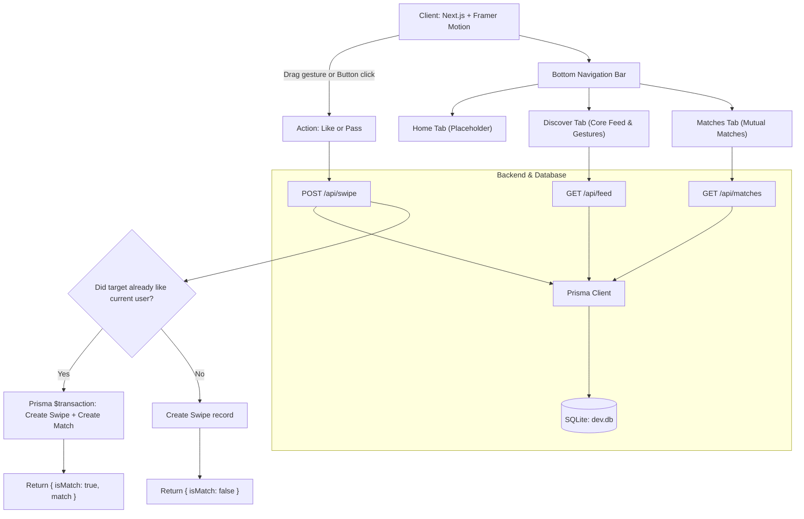

# Coy Discover 💘

[](https://nextjs.org/)
[](https://www.typescriptlang.org/)
[](https://tailwindcss.com/)
[](https://www.prisma.io/)
[](https://www.framer.com/motion/)
[](https://vitest.dev/)
[](https://opensource.org/licenses/MIT)

A production-quality standalone dating discovery web application built strictly according to the **Coy SDE Intern Assignment**. Features fluid card gestures, physical drag physics, atomic mutual matching, strict backend privacy enforcement, SQLite persistence via Prisma ORM, and responsive mobile-first design.

---

## 📱 Screenshots & UI Tour

| **Discovery Card Deck** | **"It's a Match!" Celebration** |
|:---:|:---:|
| Fluid Framer Motion touch/drag gestures with physical rotation, card stack peek, dynamic **LIKE** (emerald) and **PASS** (rose) stamp badges, and multi-photo carousel indicators. | Instant mutual match celebration with dual overlapping avatar rings, colorful particle confetti, and Web Audio harmonic arpeggio fanfare. |
|  |  |

| **Mutual Matches Grid** | **Interactive In-App Chat** |
|:---:|:---:|
| Dedicated Matches view displaying all confirmed mutual sparks with match timestamps, college badges, and quick-chat actions. | In-app conversation modal with simulated partner icebreaker, instant message sending, and bio previews. |

---

## 📸 Core Features

- 📱 **Mobile-First App Shell**: Native feel on mobile devices and an elegant centered smartphone device frame with dynamic ambient lighting on desktop.
- 🎴 **Discover Feed & Gesture Deck**:
  - Touch and drag gestures powered by **Framer Motion** (`drag="x"` with spring physics, angular velocity, and exit trajectories).
  - Physical card stack depth (shows underlying next card scaled and translated).
  - Dynamic **LIKE** (emerald) and **PASS** (rose) stamp badges with drag-offset opacity.
  - Multi-photo carousel with progress indicators and left/right navigation tap zones.
  - Expandable profile details (college, location, bio, interest tags).
  - Desktop controls: tactile Like, Pass, Superlike buttons, and keyboard navigation (`←` Pass, `→` Like).
- 🔒 **Zero-Leak Privacy Guarantees**:
  - Backend strictly strips incoming likes from `/api/feed`.
  - Non-mutual incoming likes are completely undetectable in client network payloads.
  - Matches API (`/api/matches`) exclusively yields confirmed mutual pairs.
- ⚡ **Atomic Mutual Matching**:
  - Match occurs **only if both users liked each other**.
  - Database transactions (`prisma.$transaction`) ensure atomic swipe recording and match creation.
  - Prevents race conditions and duplicate swipes via unique constraints (`@@unique([swiperId, swipedId])` and `@@unique([user1Id, user2Id])`).
- 🎉 **"It's a Match!" Celebration Screen**:
  - Celebratory spring overlay with overlapping avatar rings.
  - Zero-asset Web Audio API harmonic chime fanfare.
  - Multi-colored confetti burst via `canvas-confetti`.
  - Direct transition to chat / matches.
- 💌 **Matches View**:
  - Grid of all confirmed mutual connections with match timestamps.
  - Interactive profile preview and chat starter modal.
- 🏠 **Home Tab**:
  - Required blank placeholder view with smooth navigation to Discover.
- 🔄 **Persistence**:
  - All swipes and matches survive reloads and server restarts in SQLite (`prisma/dev.db`).

---

## 🛠 Tech Stack

| Layer | Technology | Purpose |
| :--- | :--- | :--- |
| **Frontend Framework** | Next.js 14 (App Router) | Server and Client Components, fast routing |
| **Language** | TypeScript 5 | Strict end-to-end typing across models and APIs |
| **Styling** | Tailwind CSS + PostCSS | Sleek modern dark mode UI, custom scrollbars |
| **Animations & Gestures**| Framer Motion | Touch drag physics, stamps, card exit animations |
| **Database & ORM** | SQLite + Prisma ORM | Relational schema, ACID transactions, migrations |
| **Audio Synthesis** | Web Audio API | Zero-dependency tactile sound feedback |
| **Testing** | Vitest | Integration suite verifying privacy, swipes, and matching |

---

## 🏛 System Architecture



---

## 🗄 Database Schema (`prisma/schema.prisma`)

```prisma
model User {
  id            String   @id @default(cuid())
  name          String
  age           Int
  photo         String
  photos        String   @default("[]") // JSON string of photo URLs
  bio           String
  city          String
  college       String?
  interests     String   @default("[]") // JSON string of tags
  isCurrentUser Boolean  @default(false)
  createdAt     DateTime @default(now())
  updatedAt     DateTime @updatedAt

  sentSwipes     Swipe[] @relation("Swiper")
  receivedSwipes Swipe[] @relation("Swiped")
  matchesAsUser1 Match[] @relation("MatchUser1")
  matchesAsUser2 Match[] @relation("MatchUser2")
}

model Swipe {
  id        String   @id @default(cuid())
  swiperId  String
  swipedId  String
  action    String   // "like" | "pass"
  createdAt DateTime @default(now())

  swiper User @relation("Swiper", fields: [swiperId], references: [id], onDelete: Cascade)
  swiped User @relation("Swiped", fields: [swipedId], references: [id], onDelete: Cascade)

  @@unique([swiperId, swipedId])
  @@index([swiperId])
  @@index([swipedId])
}

model Match {
  id        String   @id @default(cuid())
  user1Id   String
  user2Id   String
  createdAt DateTime @default(now())

  user1 User @relation("MatchUser1", fields: [user1Id], references: [id], onDelete: Cascade)
  user2 User @relation("MatchUser2", fields: [user2Id], references: [id], onDelete: Cascade)

  @@unique([user1Id, user2Id])
  @@index([user1Id])
  @@index([user2Id])
}
```

---

## 🔐 Strict Privacy Rules (Backend Enforced)

1. **Discovery Feed Sanitization (`/api/feed`)**:
   - Executes `NOT IN (SELECT swipedId FROM Swipe WHERE swiperId = :currentUserId)` to exclude already-swiped users.
   - Strict projection: Only public profile fields (`id`, `name`, `age`, `photo`, `photos`, `bio`, `city`, `college`, `interests`) are returned.
   - Incoming like relations (`receivedSwipes`) are never joined or serialized. Inspecting the JSON payload reveals zero indication of who liked the user.
2. **Mutual Matches Only (`/api/matches`)**:
   - Queries exclusively the `Match` table where `user1Id = :currentUserId OR user2Id = :currentUserId`.
   - Incoming one-sided likes never surface in this endpoint.
3. **Duplicate Prevention**:
   - The database unique constraint `@@unique([swiperId, swipedId])` combined with an idempotency check prevents duplicate swipes, returning HTTP `409 Conflict`.

---

## 📡 REST API Documentation

### 1. `GET /api/feed`
Returns unswiped candidate profiles for the discovery feed.

- **Request**:
  - Headers: `x-user-id` *(optional, defaults to `user-current`)*
- **Response `200 OK`**:
```json
{
  "success": true,
  "count": 32,
  "profiles": [
    {
      "id": "user-maya",
      "name": "Maya Patel",
      "age": 23,
      "photo": "https://images.unsplash.com/photo-...",
      "photos": ["https://...", "https://..."],
      "bio": "Design engineer building human-first AI...",
      "city": "San Francisco",
      "college": "Stanford University",
      "interests": ["Film Photography", "Bouldering", "Specialty Coffee"]
    }
  ]
}
```

### 2. `POST /api/swipe`
Records a swipe action on a target candidate.

- **Request**:
  - Content-Type: `application/json`
  - Body:
```json
{
  "targetUserId": "user-maya",
  "action": "like"
}
```
*(Also supports `"profileId"` in place of `"targetUserId"` and `"pass"` for action)*.

- **Response `200 OK` (Mutual Match)**:
```json
{
  "success": true,
  "action": "like",
  "isMatch": true,
  "match": {
    "id": "cuid...",
    "matchedUser": {
      "id": "user-maya",
      "name": "Maya Patel",
      "age": 23,
      "photo": "https://...",
      "bio": "...",
      "city": "San Francisco",
      "college": "Stanford University",
      "interests": ["..."]
    },
    "matchedAt": "2026-11-17T13:48:17.000Z"
  }
}
```

- **Response `200 OK` (No Match / Pass)**:
```json
{
  "success": true,
  "action": "pass",
  "isMatch": false
}
```

- **Response `409 Conflict` (Duplicate Swipe)**:
```json
{
  "success": false,
  "error": "You have already swiped on this profile",
  "alreadySwiped": true
}
```

### 3. `GET /api/matches`
Returns all confirmed mutual connections.

- **Response `200 OK`**:
```json
{
  "success": true,
  "count": 1,
  "matches": [
    {
      "id": "match-cuid",
      "matchedUser": {
        "id": "user-maya",
        "name": "Maya Patel",
        "age": 23,
        "photo": "https://...",
        "bio": "...",
        "city": "San Francisco",
        "college": "Stanford University",
        "interests": ["..."]
      },
      "matchedAt": "2026-11-17T13:48:17.000Z"
    }
  ]
}
```

### 4. `POST /api/reset`
Resets the discovery deck back to pristine seed state (32 candidate profiles, 8 pre-seeded incoming likes).

---

## 🚀 Getting Started

### Prerequisites
- Node.js 18.x or later (tested on Node.js v24)
- npm or pnpm

### 1. Installation
Clone the repository and install dependencies:
```bash
git clone <repository-url>
cd coy-discover
npm install
```

### 2. Environment Setup
Create a `.env` file in the root directory (or copy from `.env.example`):
```bash
cp .env.example .env
```
Ensure `.env` contains:
```env
DATABASE_URL="file:./dev.db"
```

### 3. Database Initialization & Seeding
Push the schema to SQLite and seed 32 realistic mock profiles:
```bash
# Push schema to SQLite
npx prisma db push

# Seed mock profiles & incoming likes
npm run db:seed
```

### 4. Run Development Server
```bash
npm run dev
```
Open [http://localhost:3000](http://localhost:3000) in your browser.

### 5. Production Build
```bash
npm run build
npm start
```

---

## 🧪 Automated Testing

The project includes an end-to-end integration test suite powered by **Vitest**, verifying all 11 required audit criteria:

```bash
npm test
```

### Test Suite Execution Output:
```
 ✓ tests/discovery.test.ts (11 tests) 449ms
   ✓ 1. All 30+ profiles have valid, complete data and realistic fields
   ✓ 2. GET /api/feed strictly excludes previously swiped profiles
   ✓ 3. POST /api/swipe correctly handles likes and passes
   ✓ 4. Mutual likes create exactly one match
   ✓ 5. GET /api/matches exposes ONLY mutual matches
   ✓ 6. No non-mutual incoming likes leak through any API response
   ✓ 7. Database persistence works after reload simulation
   ✓ 8. Duplicate swipes are prevented and return 409 Conflict
   ✓ 9. Mobile & desktop payload compatibility (targetUserId and profileId both accepted)
   ✓ 10. All required APIs return correct HTTP status codes
   ✓ 11. Image URL formats and fallback avatars are resilient

 Test Files  1 passed (1)
      Tests  11 passed (11)
   Duration  1.60s
```

---

## 💡 Evaluation & Demo Guide

- **Test a Mutual Match**: Swipe right (Like) on the first profile in the feed (**Maya Patel**). Because Maya is pre-configured with an incoming like, the **"It's a Match!" celebration modal** triggers immediately!
- **Test a Non-Match**: Swipe right (Like) on **Liam Chen**. No match modal triggers, and the swipe is recorded.
- **Test a Pass**: Swipe left (Pass) on any profile. The card flies out and the profile will never be shown again.
- **View Matches**: Switch to the **Matches** tab in the bottom navigation bar to inspect all your mutual connections and start a conversation.
- **Reset the Demo**: If you swipe through all profiles and reach the empty state, click **"Reset Discovery Deck"** (or trigger `POST /api/reset`) to restart the deck with fresh data.

---

## 📄 License
MIT License. Built for the Coy SDE Intern Assignment.
